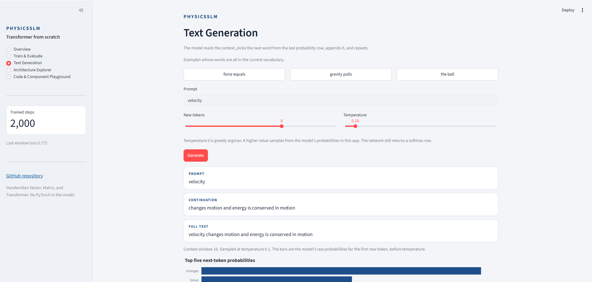

# PhysicsSLM

A decoder-only Transformer written in Python on a small `Vector` / `Matrix` library. No PyTorch in the model. It is a study model, not a production language model.

The shipped run reads `poc-corpus.txt`: a 32-word vocabulary and template continuation only. It does not answer questions and it does not do math.

**Streamlit app:** [physicsllm.streamlit.app](https://physicsllm.streamlit.app)



**Author:** [Scott Kennedy](https://github.com/scottsplays)

## Run locally

```bash
python -m venv .venv
```

Windows:

```bash
.venv\Scripts\activate
pip install -r requirements.txt
streamlit run app.py
```

macOS / Linux:

```bash
source .venv/bin/activate
pip install -r requirements.txt
streamlit run app.py
```

The app loads `physics_slm_run.json` on startup. That file is the recorded training run (weights and the losses measured during the run), so Overview shows those numbers without training again. Checkpoints under `checkpoints/` are local pickles and are not part of the repository.

## Deploy to Streamlit Community Cloud

1. Push this repository to GitHub. Include `app.py`, `requirements.txt`, `poc-corpus.txt`, `physics_slm_run.json`, and the Python modules the app imports. Do not add API keys or a Streamlit secrets file.
2. In [Streamlit Community Cloud](https://share.streamlit.io), create a new app from this repo.
3. Set the main file to `app.py`. Cloud installs `requirements.txt`. No secrets are required.

## Shipped model

| | |
| --- | --- |
| Corpus | `poc-corpus.txt` |
| Blocks | 3 |
| Width | 16 |
| Heads | 4 |
| Context | 16 |
| Steps | 1,000 |
| Learning rate | 0.05 |
| Seed | 0 |

Training windows are drawn from the first 90% of tokens. Validation loss is the mean cross-entropy of 8 fixed windows in the last 10%, forward only. The uniform baseline shown next to it is `log(32)`.

The position table has 16 rows, one per context position. A training script that allocates `len(corpus)` rows still only reads the first 16 positions.

Pressing **Start training** uses this recipe. **Reset model**, then **Start training**, trains a new model from scratch with the same settings. The numbers on the page are read from the model in memory.

The recorded run, formatted the same way the app formats them:

| | |
| --- | --- |
| Parameters | 7,648, counted from the live weight tables |
| Initial loss | 3.914 |
| Latest training-window loss | 1.617 |
| Validation loss (held-out tail) | 1.283, mean of 8 windows |
| Uniform guess | 3.466 (`log(32)`, shown as 3.47 in the caption) |
| Window accuracy | 39.0% of positions in the sampled training windows |
| Elapsed | 4m 52s |
| Greedy, three words | `force equals` → `mass times acceleration` |
| Greedy, three words | `gravity pulls` → `the box down` |

To record the run again:

```bash
python record_physics_slm_run.py
```

## What the app shows

- **Overview** — live parameter count, the recorded losses, and greedy completions.
- **Train & Evaluate** — one window per step. The sidebar value is the last window loss. Window accuracy is measured on those training windows and is not a held-out score.
- **Text Generation** — continues a prompt that is already in the vocabulary. The caption states the temperature used for that continuation.
- **Architecture Explorer** — activations and attention from a real forward pass.
- **Code & Component Playground** — the classes in `mathematics.py`, `tensor.py`, and `Transformer.py`. `dataloader.py` is shown as source only, because importing it starts a training run.

## Earlier multilayer perceptron

`iris_app.py` is the Iris / Wine / Moons demo. `python examples/train_iris.py` trains that model and writes `assets/iris_loss_curve.png`. Those files are separate from PhysicsSLM.
