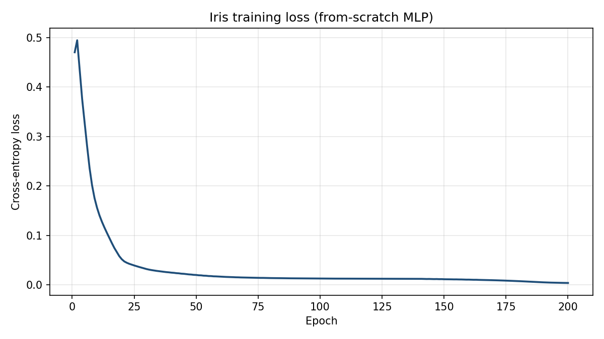

# Neural Network from Scratch (PhysicsLLM)

A feedforward neural network built from first principles in Python using custom
`Vector`, `Matrix`, `Layer`, and `Weight` classes. **No PyTorch / TensorFlow /
scikit-learn for the core model** — only plain Python, NumPy helpers for data,
and matplotlib for plots.

This repository is the current, cleaned presentation of the project. An earlier
summer version lives at
[scottsplays/neural-network-from-scratch](https://github.com/scottsplays/neural-network-from-scratch).

**Author:** [Scott Kennedy](https://github.com/scottsplays)  
**Status:** Educational MLP checkpoint (classification on Iris). Larger goals
(embeddings + a small physics language model) are planned, but **not** part of
this release.

---

## Why this project exists

This repo shows a full training loop implemented by hand:

- Custom linear algebra (`Vector` / `Matrix`)
- Dense layers with bias-in-weights
- Manual forward pass and backpropagation
- ReLU / linear activations
- Softmax + cross-entropy for multiclass classification
- Feature standardization and train/test evaluation
- Side-by-side PyTorch comparison notebook (Colab)

It is a learning / portfolio project, not a production framework.

---

## Quick start

```bash
python -m venv .venv
# Windows
.venv\Scripts\activate
# macOS / Linux
# source .venv/bin/activate

pip install -r requirements.txt
```

**Train on Iris (flower dataset) and save a loss curve:**

```bash
python examples/train_iris.py
```

Output image: `assets/iris_loss_curve.png`

You can also run the library scripts directly:

```bash
python dataloader.py   # Iris download + train loop
python model.py        # minimal smoke import / demo model
```

**PyTorch comparison (Google Colab):** open `PyTorch.ipynb`.

---

## Architecture (this release)

```
Input (4 Iris features)
        ↓
  Dense + ReLU   (8)
        ↓
  Dense + ReLU   (8)
        ↓
  Dense + linear (3 logits)
        ↓
  Softmax → cross-entropy → backprop (δz = p − y) → SGD update
```

Convention: row-vector matmul \(z = x_b W\) with bias stored as an extra row of \(W\).

---

## Core components

| Module | What it does |
|--------|----------------|
| `tensor.py` | `Vector` and `Matrix` math, softmax, bias helpers |
| `layer.py` | `Layer` activations + `Weight` forward/backward |
| `model.py` | 3-layer MLP, softmax, train loop |
| `mathematics.py` | Activations, CE / MSE losses and grads |
| `dataloader.py` | Iris CSV load, one-hot, standardize, train |
| `visualize.py` | Simple matplotlib helpers |
| `ARCHITECTURE.md` | Deeper notes on each type + math |
| `PyTorch.ipynb` | Same Iris task in PyTorch (Colab) |
| `examples/train_iris.py` | Reproducible Iris run + loss curve export |

---

## Building blocks (brief)

### Vector
1-D array of activations or features. Supports element-wise ops, dot/`@`,
`softmax`, and the bias trick (`append(1)`).

### Matrix
2-D array of row vectors. Supports matmul, transpose, and shape checks used by
dense layers.

### Layer
A vector of unit activations for one network depth. `forward(weight)` computes
\(x_b W\), applies the layer activation, and caches intermediates on `Weight`.

### Weight
Learnable dense connection \(W\) plus activation. Backward uses cached \(x,z,y\)
to form \(\partial L/\partial W\) and the incoming gradient for the previous layer.

See **[ARCHITECTURE.md](ARCHITECTURE.md)** for formulas.

---

## Example results (Iris)

Iris is a classic 3-class flower dataset (setosa / versicolor / virginica) with
4 numeric features.

- Architecture: `4 → 8 (ReLU) → 8 (ReLU) → 3 (linear) + softmax`
- Loss: cross-entropy
- Optimizer: online SGD (`lr ≈ 0.01`)
- Features: column-wise standardization

Typical runs reach **high train/test accuracy** (often mid–high 90%s depending
on split/seed). A representative loss curve:



---

## Design notes

- **No high-level ML frameworks in the core path** — autodiff is explicit.
- **Softmax + CE** use the combined logit gradient \(p - y\).
- **Online SGD** updates after every sample (loss curves can wiggle).
- External deps: `numpy`, `pandas` (Iris CSV), `matplotlib` (plots).

---

## Future work (not in this release)

This checkpoint stops at a working from-scratch MLP. Planned directions for
**PhysicsLLM**:

1. **Token / character embeddings** for text
2. **Attention** and transformer-style blocks
3. A **small language model (SLM)** trained on physics texts
4. Model **save/load**, cleaner package layout, and faster matmul backends

The earlier summer repo focused on regression-style MMSE demos (synthetic + wine).
This release focuses on multiclass Iris + CE/softmax as a stronger classification
baseline before sequence modeling.

---

## Project structure

```
.
├── tensor.py
├── layer.py
├── model.py
├── mathematics.py
├── dataloader.py
├── visualize.py
├── ARCHITECTURE.md
├── PyTorch.ipynb
├── examples/
│   └── train_iris.py
├── assets/
│   └── iris_loss_curve.png
├── requirements.txt
├── LICENSE
└── README.md
```

---

## License

MIT License. See [LICENSE](LICENSE).
